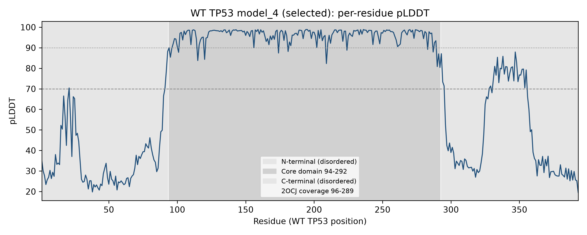
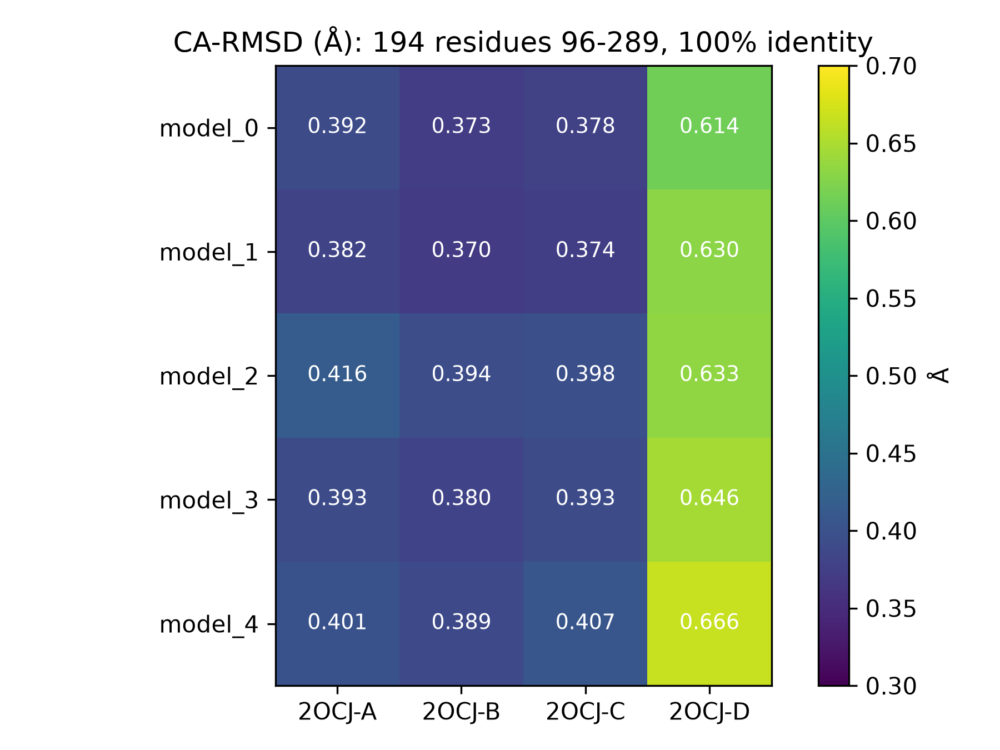
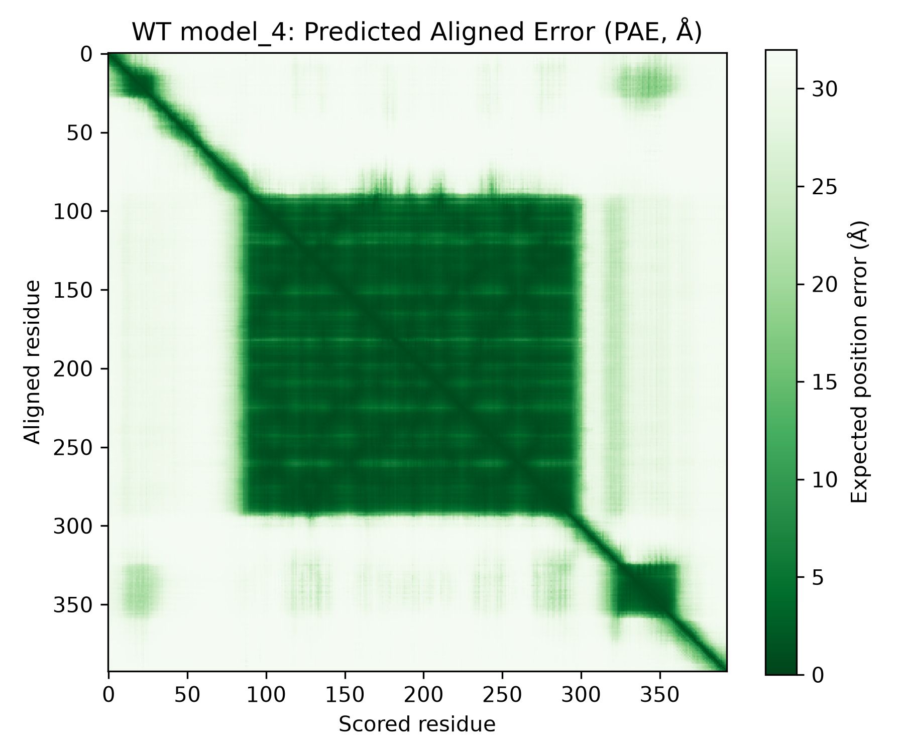
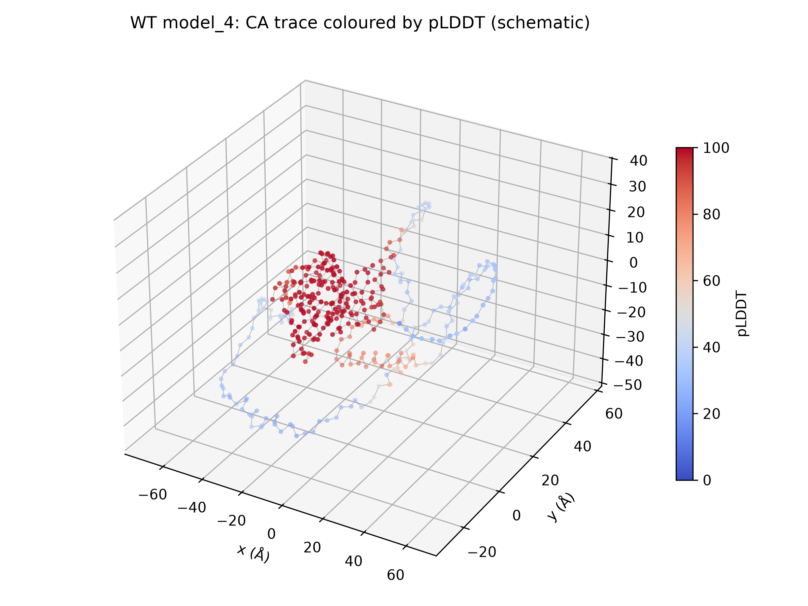
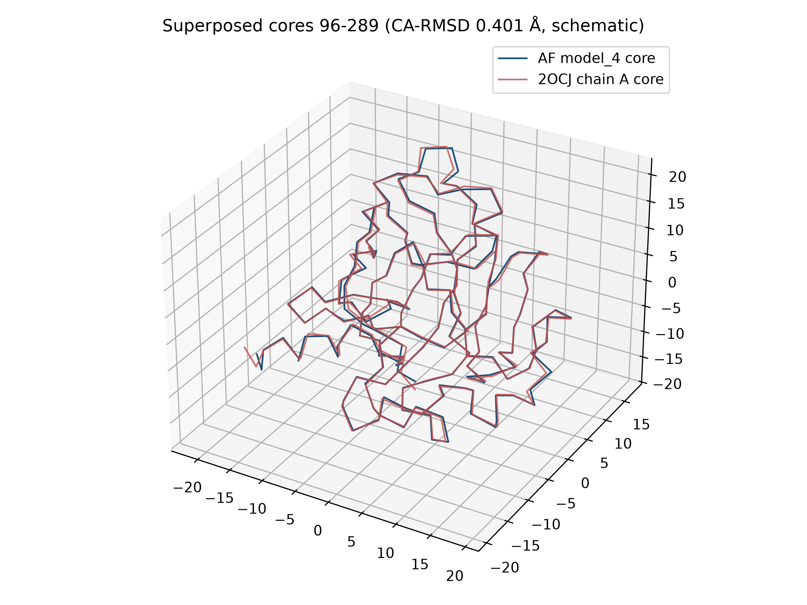
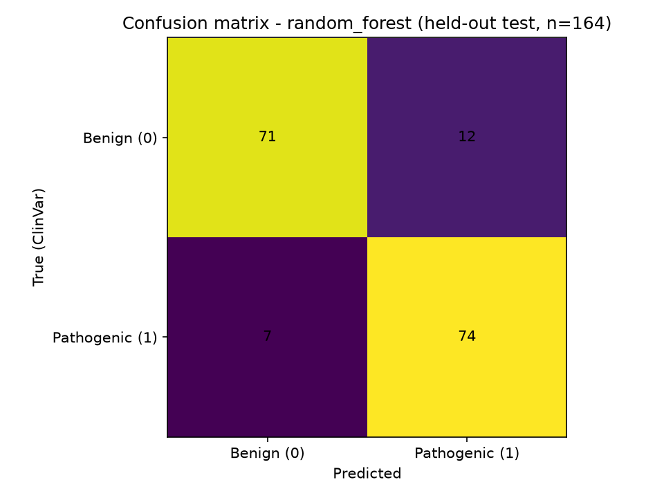
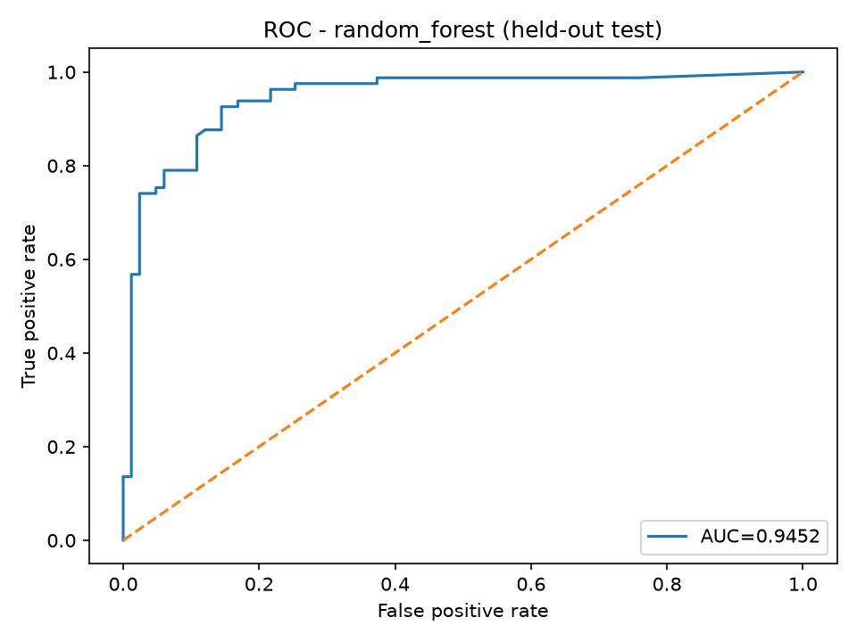
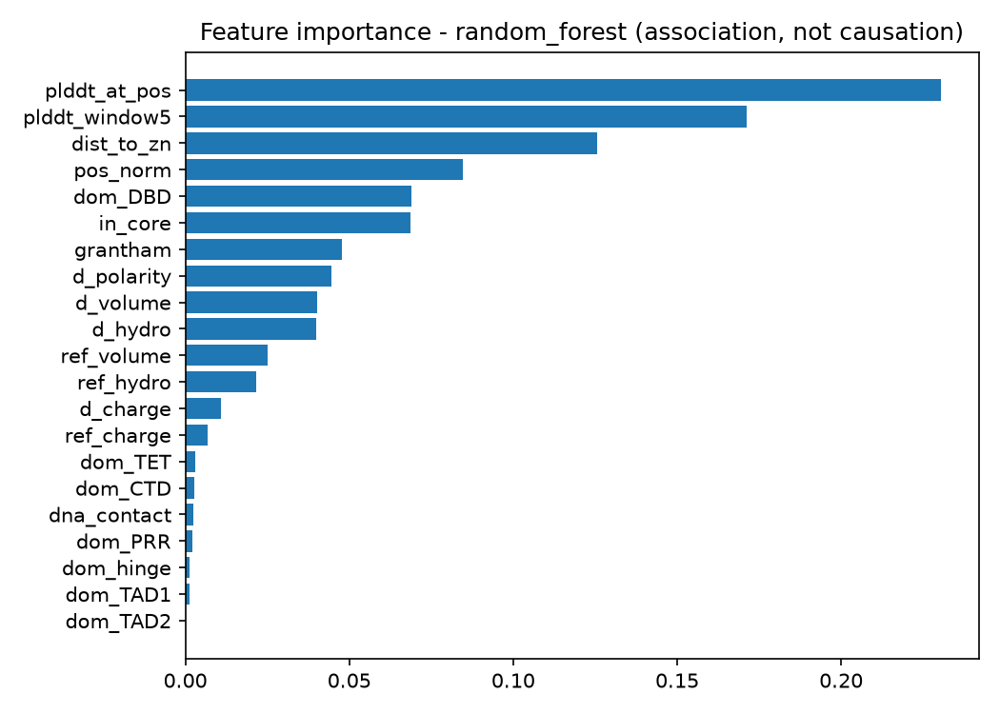

# TP53 Mutation Analysis: Sequence, Structure, and Machine Learning

[](https://www.python.org)
[](https://numpy.org)
[](https://matplotlib.org)
[](https://pymol.org)
[](https://alphafoldserver.com)
[](LICENSE)

## Project Description

A complete, reproducible computational workflow for the analysis of TP53
variant effects using sequence verification, **AlphaFold** structural
prediction, structural validation against experimentally determined data
(**PDB 2OCJ**), WT-vs-mutant structural comparison, feature engineering, and
machine learning. The project starts from the TP53 coding sequence
(**NM_001126112.3**, CDS 140–1321), derives and formally verifies a 393-aa
wild-type protein, validates the predicted WT structure against experimental
data, and scaffolds the downstream variant and machine-learning stages.

All results, figures, and scripts are included — the repository is fully
reproducible and suitable for academic review, collaboration, and
portfolio/research presentation.

## Background

TP53 (Homo sapiens, NCBI Gene ID 7157) encodes cellular tumor antigen p53, a
transcription factor and tumor suppressor. The canonical full-length isoform
is 393 amino acids (UniProt P04637): disordered N- and C-terminal regions
flank a structured central DNA-binding (core) domain (~residues 94–292), the
hotspot for cancer-associated missense variants. Most experimentally
determined TP53 structures, including PDB 2OCJ, cover the core domain only —
so any predicted full-length model can only be benchmarked on overlapping
residues. This project establishes that WT structural baseline first, before
any variant or machine-learning analysis. See
`docs/research/biological_background.md`.

## Objectives

The objective of this project is **not** to claim pathogenicity but to:

1. Derive and formally verify a 393-aa WT TP53 sequence from the selected CDS.
2. Analyse all AlphaFold WT models and select a representative on evidence.
3. Validate the WT model against experimental data (2OCJ) on overlapping
   residues, reporting RMSD, aligned residues, and identity.
4. Build a provenance-tracked variant dataset (no invented mutations).
5. Compare WT vs mutant structures with quantitative descriptors.
6. Engineer documented sequence/structural features and evaluate whether
   machine-learning models can learn patterns associated with curated
   variant annotations — reporting association, never causation.

## Research Questions

- **RQ1 (answered):** Can a reproducible WT TP53 sequence be obtained and
  verified from the selected CDS? — Yes: 100% identity to live UniProt P04637.
- **RQ2 (answered):** Can AlphaFold generate a WT model quantitatively
  comparable with experimental TP53 data? — Yes: 0.37–0.67 Å CA-RMSD over
  194 core residues (consistency, not blind validation — templates enabled).
- **RQ3 (answered, prototype):** How do selected variants alter sequence/structure
  features vs WT? — 818 ClinVar missense variants featurized vs the verified
  WT (domain, Grantham/physicochemical deltas, WT pLDDT context); demo table
  in `results/mutations/wt_vs_mutant.md`.
- **RQ4 (answered, prototype):** Can these features inform classification of curated
  variant annotations? — Yes: logistic regression and random forest baselines,
  plus a 10-algorithm benchmark under one fair protocol (stratified 80/20,
  seed 42, 5-fold CV on train). Held-out test on expanded n=818 set: RF
  accuracy 0.884 / F1 0.886 / ROC-AUC 0.945 on 164 variants (association
  with ClinVar annotations, never causation). Full tables:
  `results/machine_learning/benchmark/benchmark_report.md`. Small-data
  prototype caveats apply.
- **RQ5 (answered, prototype):** Which features contribute most to predictions?
  — WT pLDDT context, Zn-ligand distance, position/core flags rank highest
  (`figures/machine_learning/feature_importance.png`), reported as association.

Details: `docs/research/research_questions.md`.

## Workflow

```
TP53 CDS (NM_001126112.3:140-1321)
        ↓
CDS Verification → ORF Identification → Protein Translation
        ↓
Protein Sequence Verification (UniProt P04637) ✅ RQ1
        ↓
AlphaFold Structural Prediction (5 models)
        ↓
AlphaFold Confidence Analysis (pLDDT / PAE)
        ↓
Representative Model Selection (model_4)
        ↓
Experimental Benchmark Retrieval (PDB 2OCJ, X-ray 2.05 Å)
        ↓
Overlap-Restricted Structural Alignment ✅ RQ2 (RMSD 0.37-0.67 Å)
        ↓
Variant Dataset (ClinVar TP53, 818 missense, traceable VCV IDs) ✅ RQ3
        ↓
Mutant Feature Extraction (21 sequence/structural features, leak-free)
        ↓
Train / Test Split (stratified 80/20, seed 42, scaling fit on train only)
        ↓
Machine Learning (multi-model benchmark: 3 classifiers, fair protocol)
        ↓
Model Evaluation (held-out test + 5-fold CV) + Explainability ✅ RQ5
        ↓
TP53 Variant Prediction (scripts/machine_learning/predict.py)
        ↓
HTML Prediction Dashboard (dashboard/server.py + index.html)
```

Current position: WT baseline + variant/ML/predictor complete (academic
prototype); PyMOL cartoon cross-check figures remain pending.

## Installation

### Prerequisites

- Python (≥ 3.10)
- PyMOL (≥ 2.5) — for the structural cross-check only

### Setup

```bash
# Clone the repository
git clone https://github.com/simbisaichinhema/TP53-Sequence-Structure-and-Machine-Learning-.git
cd TP53-Sequence-Structure-and-Machine-Learning-

# Create the environment
conda env create -f config/environment.yml
conda activate tp53-analysis
```

### Required Python Packages

| Package | Source | Purpose |
|---|---|---|
| numpy | PyPI/conda | Kabsch superposition, confidence statistics |
| pandas | PyPI/conda | Variant/feature tables |
| scikit-learn | PyPI/conda | Baselines + benchmark models, metrics, CV |
| matplotlib | PyPI/conda | Publication-quality figures |
| joblib | PyPI/conda | Model artefact save/load |
| scipy | PyPI/conda | sklearn dependency |
| PyYAML | PyPI/conda | Config |
| xgboost, lightgbm, catboost | PyPI (optional) | Booster models in the benchmark |
| PyMOL | External | Independent alignment cross-check |
| AlphaFold Server | External | WT structure prediction (already run) |

`config/environment.yml` pins Biopython, pandas, scikit-learn, matplotlib,
PyYAML, joblib, and the optional boosters. For a pip-only setup:

```bash
python3 -m venv .venv && source .venv/bin/activate
pip install -r config/requirements-benchmark.txt
```

If xgboost / lightgbm / catboost are missing, `benchmark_models.py` skips
those models and records the skip in `experiment_config.json` — the
remaining models still run.

## Folder Structure

```
TP53-Mutation-Analysis/
├── README.md                  # This file
├── LICENSE                    # MIT License
├── CITATION.cff               # Machine-readable citation
├── CHANGELOG.md               # Versioned research log
├── .gitignore                 # Exclude generated files
│
├── data/
│   ├── raw/tp53_cds/          # NCBI CDS set, live UniProt retrieval, local copies
│   ├── raw/variants/          # ClinVar esearch IDs + clean provenance (16 MB
│   │                          #   esummary dump git-ignored, regenerable)
│   ├── processed/protein/     # Verified 393-aa WT translation
│   ├── processed/mutations/   # tp53_variant_dataset.csv (818, VCV-traceable)
│   ├── processed/structural_features/  # tp53_features.csv (818×21) + definitions
│   └── metadata/              # sequence/structure/variant provenance CSVs
│
├── structures/
│   ├── alphafold/wt/raw/      # All 5 models + full_data + original bundle
│   ├── alphafold/wt/selected/ # Representative model_4 + record
│   ├── alphafold/wt/confidence/  # Summary JSONs + job request
│   ├── alphafold/wt/inputs/   # MSAs + templates (5XZC/6RZ3/4QO1/2WGX)
│   ├── experimental/2OCJ/     # 2OCJ.cif (X-ray, 2.05 Å)
│   ├── mutants/               # (empty — NOT STARTED)
│   └── aligned/               # (PyMOL session pending)
│
├── scripts/
│   ├── sequence/              # verify_sequence.py
│   ├── structure/             # analyze_confidence.py, superpose_core.py,
│   │                          # plot_validation_figures.py, align_wt_experimental.pml
│   ├── mutation/              # fetch_clinvar_tp53.py (live ClinVar build)
│   └── machine_learning/      # make_features.py, train.py, predict.py,
│                              # write_results_docs.py, benchmark_models.py,
│                              # model_registry.py, metrics_utils.py,
│                              # tune_models.py, position_aware_validation.py
│
├── dashboard/
│   ├── server.py              # stdlib inference server (real model)
│   └── index.html             # predictor UI (pos/ref/alt → class + proba)
│
├── results/
│   ├── sequence/              # sequence_verification.md
│   ├── structure/             # alphafold_confidence.md, wt_validation.md,
│   │                          # superposition.json
│   ├── mutations/             # wt_vs_mutant.md (demo-variant comparison)
│   ├── machine_learning/      # evaluation.md, metrics.json, model.joblib
│   │                          # (joblib regenerable, git-ignored)
│   └── machine_learning/benchmark/     # multi-model CSV/JSON/report/models
│       └── position_aware/             # GroupKFold + leave-hotspot-out
│
├── figures/
│   ├── structures/            # Per-residue pLDDT plot
│   ├── alignments/            # RMSD heatmap
│   ├── machine_learning/      # Confusion matrix, ROC, importance, class dist
│   └── workflow|sequence/     # (pending)
│
├── notebooks/                 # (conventions README; analyses pending baseline)
├── docs/research/             # Questions, status, background, file audit
├── docs/protocols/            # Sequence + structural validation protocols
├── docs/methods/              # methods.md
└── config/                    # analysis_config.yaml, environment.yml
```

## How to Run

Each script is self-contained and documents its own inputs and outputs. From
the repository root (use `python3` if `python` maps to Python 2):

```bash
# Step 1 — Verify the WT sequence against live UniProt P04637
python scripts/sequence/verify_sequence.py --reference data/raw/tp53_cds/P04637_uniprot_live_20260918.fasta

# Step 2 — Summarise AlphaFold confidence across all 5 models
python scripts/structure/analyze_confidence.py

# Step 3 — Overlap-restricted superposition vs 2OCJ (+ model selection)
python scripts/structure/superpose_core.py

# Step 4 — Generate validation figures
python scripts/structure/plot_validation_figures.py

# Step 5 — PAE heatmap, 3D structure views, superposed-core overlay
python scripts/structure/plot_structure_views.py

# Step 6 — Fetch ClinVar TP53 variants → clear-label set (388)
python3 scripts/mutation/fetch_clinvar_tp53.py
# Step 6b — Expand conflicting missense by submitter majority vote → 818
python3 scripts/mutation/expand_clinvar_conflicts.py --sleep 0.35

# Step 7 — Feature extraction (21 sequence/structural features, leak-free)
python3 scripts/machine_learning/make_features.py

# Step 8 — Train baselines + evaluate on held-out test set
python3 scripts/machine_learning/train.py

# Step 8b — Multi-model benchmark (3 classifiers, fair protocol)
python3 scripts/machine_learning/benchmark_models.py

# Step 8c — Train-only hyperparameter search for top-3 CV models
python3 scripts/machine_learning/tune_models.py --top-k 3

# Step 8d — Position-aware / leave-one-hotspot-out (separate experiment)
python3 scripts/machine_learning/position_aware_validation.py

# Step 9 — Predict a single variant with the real model
python3 scripts/machine_learning/predict.py R 175 H
# optional: use a benchmark artefact instead of the default RF
python3 scripts/machine_learning/predict.py \
  --model results/machine_learning/benchmark/models/extra_trees.joblib R 175 H

# Step 10 — Launch the HTML prediction dashboard
python3 dashboard/server.py
# open http://127.0.0.1:8000 — demo: R175H, R248Q, R273H, Y220C, G245S, P72R

# Step 11 — Smoke-test the benchmark upgrade
python3 scripts/machine_learning/test_benchmark_smoke.py
```

PyMOL cross-check (pending installation verification):

```bash
pymol scripts/structure/align_wt_experimental.pml
```

### Expected Runtime

| Script | Approximate Runtime |
|---|---|
| `verify_sequence.py` | < 1 min |
| `analyze_confidence.py` | < 1 min |
| `superpose_core.py` | < 1 min |
| `plot_validation_figures.py` | 1–2 min |
| `plot_structure_views.py` | 1–2 min |
| `fetch_clinvar_tp53.py` | 2–4 min (live ClinVar E-utilities) |
| `expand_clinvar_conflicts.py` | ~3–5 min (VCV XML majority-vote; rate-limited) |
| `make_features.py` | < 1 min |
| `train.py` | 1–2 min |
| `benchmark_models.py` | ~1–3 min (3 models, n=818) |
| `tune_models.py` | ~2–5 min (top-3 models, small grids) |
| `position_aware_validation.py` | ~1–3 min |
| `predict.py` | seconds |
| `dashboard/server.py` | persistent (starts in ~20 s with model preload) |

## Expected Outputs

| Location | Contents |
|---|---|
| `results/sequence/sequence_verification.md` | 100% identity (393/393) vs live P04637 |
| `results/structure/alphafold_confidence.md` | Per-model pLDDT/PAE summary table |
| `results/structure/superposition.json` | RMSD table, all models × 2OCJ chains A–D |
| `results/structure/wt_validation.md` | 2OCJ annotation, selection rationale, RMSD table |
| `structures/alphafold/wt/selected/wt_selected.cif` | Representative model_4 |
| `figures/structures/wt_selected_per_residue_plddt.png` | pLDDT profile (300 dpi) |
| `figures/structures/wt_model4_pae.png` | PAE heatmap, model_4 (300 dpi) |
| `figures/structures/wt_model4_3d_plddt.png` | 3D CA trace by pLDDT (300 dpi) |
| `figures/alignments/rmsd_models_vs_2ocj.png` | RMSD heatmap (300 dpi) |
| `figures/alignments/wt_vs_2ocj_core_overlay_3d.png` | Superposed cores (300 dpi) |
| `data/processed/mutations/tp53_variant_dataset.csv` | 818 ClinVar missense variants with labels + VCV provenance + `label_basis` |
| `data/processed/structural_features/tp53_features.csv` | 818 × 21 feature matrix (definitions in `feature_definitions.md`) |
| `results/machine_learning/metrics.json` + `evaluation.md` | Real CV + held-out test metrics |
| `results/machine_learning/model.joblib` | Trained random-forest pipeline (regenerable via `train.py`) |
| `results/machine_learning/benchmark/benchmark_results.csv` / `.json` | All algorithms × all metrics (CV mean±SD + test) |
| `results/machine_learning/benchmark/benchmark_report.md` | Concise consolidated benchmark report |
| `results/machine_learning/benchmark/experiment_config.json` | Seed, split, features, scaling/balance policy, missing packages |
| `results/machine_learning/benchmark/cv_folds.json` | Per-fold CV metrics |
| `results/machine_learning/benchmark/models/*.joblib` | Fitted pipelines for every model (baseline + tuned) |
| `results/machine_learning/benchmark/tuned_benchmark.*` + `tuning_report.md` | Train-only hyperparameter search results (kept separate from baseline) |
| `results/machine_learning/position_aware/` | GroupKFold-by-position + leave-one-hotspot-out results |
| `figures/machine_learning/benchmark/*.png` | Accuracy/F1/ROC-AUC/PR-AUC bars, ROC & PR curves, confusion matrices, CV variability |
| `results/mutations/wt_vs_mutant.md` | Demo-variant structural comparison + real predictions |
| `figures/machine_learning/` | Confusion matrix, ROC, feature importance, class distribution |
| `dashboard/` | `server.py` + `index.html` — predictor backed by the real model |
| `data/processed/mutations/mutant_sequences.fasta` | 818 real mutant proteins (validated single substitutions, 393 aa) |
| `results/machine_learning/all_predictions.csv` | Per-variant prediction audit (label, split, pred, proba) |
| `results/machine_learning/cohort_summary.json` | Per-split metrics + misclassified list |
| `results/mutations/variant_proteins.md` | WT-vs-mutant windows + test error analysis |
| `figures/machine_learning/` | + position_enrichment, plddt_by_class, substitution_counts |

## Results Summary

| Metric | Value |
|---|---|
| WT protein length | 393 aa |
| Sequence identity vs live UniProt P04637 (SV=4) | 393/393 (100%) |
| AlphaFold models analysed | 5 (all preserved) |
| Core (94–292) mean pLDDT, selected model_4 | 97.89 |
| N-terminal (1–93) mean pLDDT | 36–39 (disordered, expected) |
| C-terminal (293–393) mean pLDDT | 51–53 (disordered, expected) |
| Experimental benchmark | 2OCJ, X-ray, 2.05 Å, residues 96–289 |
| Aligned residues (overlap only) | 194 CA |
| Sequence identity over overlap | 194/194 (100%) |
| CA-RMSD, all models × chains A–D | 0.37–0.67 Å |
| Variant dataset (ClinVar TP53 missense, traceable VCV) | 818 (405 pathogenic / 413 benign; clear + conflict-majority) |
| Features per variant | 21 (position, domain, Zn-distance, Grantham + deltas, WT pLDDT, DNA-contact) |
| ML split | stratified 80/20, seed 42 (train 654 / test 164) |
| Random forest (selected baseline): test accuracy / F1 / ROC-AUC | 0.884 / 0.886 / 0.945 |
| Logistic regression (baseline): test accuracy / F1 / ROC-AUC | 0.842 / 0.857 / 0.917 |
| Multi-model benchmark | 3 classifiers, same split/CV/features (see `results/machine_learning/benchmark/benchmark_report.md`) |
| Best CV ROC-AUC in benchmark (train CV, selection metric) | verify in `benchmark_results.csv` — numbers are generated, not hand-copied |
| Dashboard | live at `http://127.0.0.1:8000` via `dashboard/server.py` (real model) |

Benchmark numbers in `results/machine_learning/benchmark/` are written by
`benchmark_models.py` from measured predictions — do not treat README prose
as the source of truth for model ranking.

### Key Points

- All five WT models are effectively equivalent — model_4 is a nominal
  representative, not a qualitatively better model.
- Sub-angstrom agreement is restricted to the ordered core; termini are
  low-confidence and unbenchmarked.
- Templates from the same fold family (5XZC/6RZ3/4QO1/2WGX) were enabled at
  prediction, so agreement reads as consistency, not blind validation.

## Figures

### Per-Residue pLDDT, Selected Model (model_4)



Confident core (~98) flanked by low-confidence termini; red hatching marks
the 2OCJ-covered interval (96–289).

### RMSD: All Models vs 2OCJ Chains



CA-RMSD (Å) over 194 overlapping residues at 100% identity. Generated by
`scripts/structure/plot_validation_figures.py` from measured data.

### PAE Heatmap, Selected Model (model_4)



Predicted Aligned Error (mean 21.25 Å; low within the core block,
high between the core and the disordered termini).

### Predicted Structure in 3D (model_4, CA trace by pLDDT)



Schematic CA-trace rendering (matplotlib 3D, not a PyMOL cartoon):
compact high-confidence core with extended low-confidence termini.

### Superposed Cores: Model_4 vs 2OCJ Chain A



Kabsch-superposed CA traces, residues 96–289 (0.401 Å RMSD). PyMOL
cartoon figures remain pending.

### ML Evaluation: Confusion Matrix (held-out test, n=164)



Random forest: TN=71, FP=12, FN=7, TP=74 (accuracy 0.884, F1 0.886).
Generated by `scripts/machine_learning/train.py` from measured predictions.

### ML Evaluation: ROC Curve



Test ROC-AUC 0.945 (random forest) vs 0.917 (logistic regression).

### Feature Importance (association, not causation)



WT pLDDT context, Zn-ligand distance, and core/position flags dominate —
consistent with pathogenic missense enriching in the ordered core domain.

## Multi-model benchmark

### Default algorithms (3 best)

Selected by train CV ROC-AUC on the expanded cohort (n=818). All three
share the same fair protocol; the remaining registry models remain
available via `--models`.

| # | Model key | Algorithm | Scaling | Class balance | Dependency |
|---|---|---|---|---|---|
| 1 | `extra_trees` | Extra Trees | none | balanced_subsample | sklearn |
| 2 | `random_forest` | Random Forest (baseline) | none | balanced_subsample | sklearn |
| 3 | `catboost` | CatBoost | none | balanced sample_weight | **optional** `catboost` |

Additional registered classifiers (`logistic_regression`, `svm`,
`gradient_boosting`, `hist_gradient_boosting`, `xgboost`, `lightgbm`,
`adaboost`) can be run explicitly with `--models <names...>`. Missing
optional packages are skipped gracefully and listed in
`experiment_config.json`.

### Evaluation methodology (fair protocol)

All models share:

1. The **same 21-column feature matrix** (`tp53_features.csv`, n=818).
2. The **same stratified 80/20 train/test split**, seed **42**
   (train=654, test=164).
3. The **same 5-fold stratified cross-validation** on the training
   partition only.
4. **Training-only preprocessing**: `StandardScaler` lives inside the
   sklearn `Pipeline` and is fit on each training fold (linear models
   and SVM only; trees are not needlessly scaled).
5. Balanced class/sample weights fit from training-fold labels only.

Leakage controls:

- Imputation/scaling/feature selection (none beyond scaling here) are
  fit inside the pipeline on training data only.
- The **held-out test set is never used** for hyperparameter tuning or
  model selection. Selection uses mean CV ROC-AUC on train.
- Hyperparameter search (`tune_models.py`) writes to separate files;
  baseline results stay untouched.

### Metrics

| Metric | Meaning |
|---|---|
| Accuracy | Fraction correct (can mislead under imbalance) |
| Balanced accuracy | Mean of sensitivity and specificity |
| Precision | PPV: of predicted pathogenic, fraction truly pathogenic |
| Recall / Sensitivity | Of truly pathogenic, fraction detected (TP rate) |
| Specificity | Of truly benign, fraction correctly negative (TN rate) |
| F1 | Harmonic mean of precision and recall |
| ROC-AUC | Ranking quality across thresholds (threshold-free) |
| PR-AUC / Average Precision | Precision–recall summary; sensitive to prevalence |
| MCC | Matthews correlation coefficient (−1…1; robust to imbalance) |
| Confusion matrix | TN, FP, FN, TP counts on the evaluation set |

For CV, reports show **mean ± SD** across the 5 folds (train partition).
For the held-out test, each metric is reported once (n=164).

### Running the benchmark

```bash
python3 scripts/machine_learning/benchmark_models.py
python3 scripts/machine_learning/tune_models.py --top-k 3
python3 scripts/machine_learning/position_aware_validation.py
```

Outputs land in `results/machine_learning/benchmark/` and
`figures/machine_learning/benchmark/` (see Expected Outputs).

### Prediction with any benchmark model

```bash
python3 scripts/machine_learning/predict.py R 175 H   # default: model.joblib
python3 scripts/machine_learning/predict.py \
  --model results/machine_learning/benchmark/models/extra_trees.joblib R 175 H
```

The default `results/machine_learning/model.joblib` (baseline RF from
`train.py`) is unchanged; the dashboard continues to use it.

## Limitations

- Full-length prediction vs core-domain experiment: only residues 96–289 are
  comparable; terminal regions have no experimental benchmark here.
- Template-enabled prediction against a long-known fold: agreement measures
  consistency, not independent predictive power.
- ML is an academic prototype (n=818 ClinVar germline missense): it associates
  features with curated annotations and is NOT clinically validated or a
  diagnostic tool. **Do not read benchmark scores as clinical performance.**
- **Random stratified split limitation:** variants from the same residue or
  hotspot (e.g. R175, R248, R273) may appear in both training and testing.
  Position features carry strong signal, so random-split estimates can be
  optimistic. `position_aware_validation.py` implements GroupKFold-by-residue
  and leave-one-hotspot-out as a **separate** validation experiment for this.
- Small test set (n=164): metric differences between models are noisy; no
  nested CV / external cohort yet.
- Mutant structures were not re-predicted; structural features reuse the
  validated WT model context (pLDDT) plus sequence-derived deltas.
- Difficult variants were not removed and labels were not modified to improve
  scores.

## Future Work

PyMOL cartoon cross-check → larger multi-source dataset (COSMIC / IARC TP53 /
cBioPortal) → mutant structure prediction → nested CV / external test set →
calibration → fuller position-aware and leave-one-hotspot-out reporting →
independent cohort validation.

## Reproducibility

- Raw data are never overwritten; scripts read `raw/` and write
  `processed/` / `results/` / `figures/`.
- Single source of truth: `config/analysis_config.yaml`; environments:
  `config/environment.yml`.
- The Kabsch implementation carries a synthetic rotation-recovery self-test
  (passes at ~1e-15 Å); GUI steps are recorded as PyMOL command scripts.
- Provenance for every external file: `data/metadata/*.csv`.

## References

- NCBI Gene TP53 (GeneID 7157); transcript NM_001126112.3
- UniProt P04637 (P53_HUMAN), SV=4 — https://www.uniprot.org/uniprotkb/P04637
- PDB 2OCJ: Wang, Y., Rosengarth, A., & Luecke, H. (2007). Structure of the
  human p53 core domain in the absence of DNA. *Acta Crystallogr D Biol
  Crystallogr*, 63, 276–281. DOI:
  [10.1107/S0907444906048499](https://doi.org/10.1107/S0907444906048499)
- AlphaFold Server — https://alphafoldserver.com (prediction job request and
  Output Terms of Use preserved in `structures/alphafold/wt/`)

## Citation

If you use this repository, please cite it as below (see `CITATION.cff`).

```bibtex
@software{tp53mutationanalysis2026,
  author  = {{TP53 Mutation Analysis contributors}},
  title   = {TP53 Mutation Analysis: Sequence, Structure, and Machine Learning},
  year    = {2026},
  url     = {TP53-Mutation-Analysis},
  license = {MIT},
  note    = {WT sequence verified vs UniProt P04637; AlphaFold models validated vs PDB 2OCJ}
}
```

## Author

**Simbisai Chinhema** — Bioinformatics

## Contributors

- **Simbisai Chinhema** — Bioinformatics (Author & Developer)

## License

This project is licensed under the [MIT License](LICENSE). Third-party data
(NCBI, UniProt, PDB, AlphaFold output) remain subject to their original
terms — see `data/metadata/` and `structures/alphafold/wt/terms_of_use.md`.

## Acknowledgements

- NCBI, UniProt, and the RCSB PDB for open data; the depositors and authors
  of 2OCJ.
- Google DeepMind / AlphaFold Server for structure prediction.
- The NumPy, matplotlib, and PyMOL communities for open tooling.
